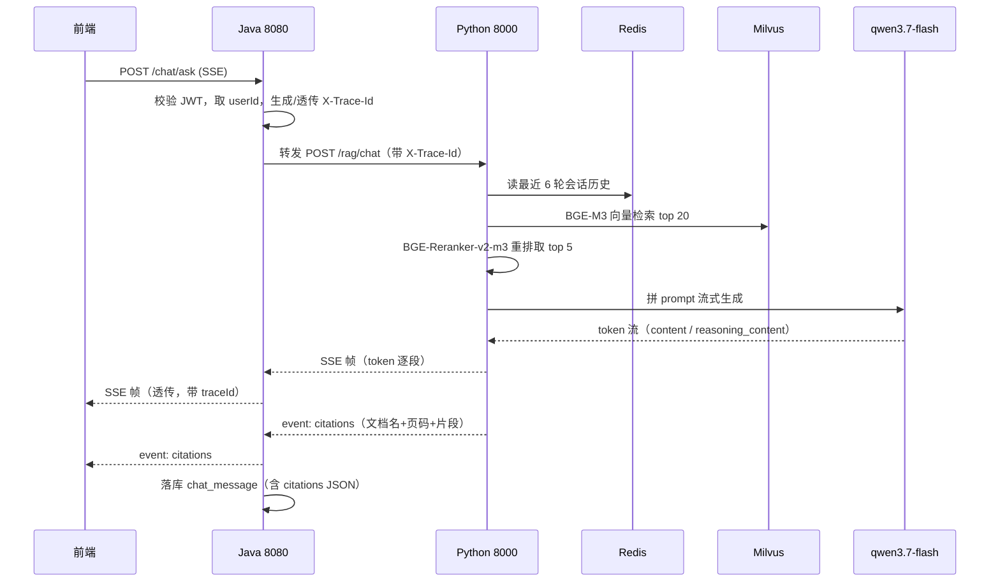
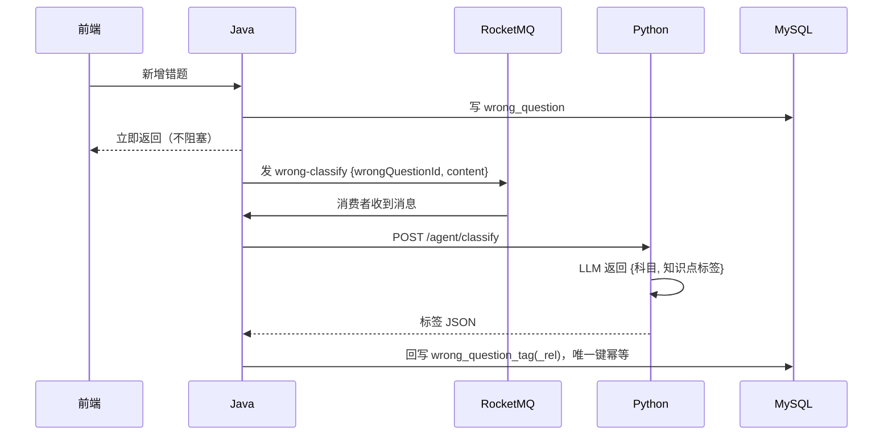

# 备考学习 Agent 系统（study-agent）

> 面向考研 / 考公人群的个性化学习 Agent 系统。  
> Java 做业务工程化，Python 做 AI 能力，双栈分工明确。

---

## 一、项目简介

把"定计划 → 做任务 → 记错题 → 复盘 → 问答"这条备考闭环做成一个系统，其中三件事交给 AI：

1. **RAG 问答**：上传自己的资料（PDF / Word），基于资料库回答问题，**每个回答都带引用溯源**（文档名 + 页码），资料里没有的内容明确说不知道。
2. **规划 Agent**：输入"3 个月考研英语二、每天 2 小时"，LangGraph 编排的 Agent 自动拆成逐日任务并入库。
3. **异步 AI 处理**：错题自动打知识点标签、每周自动生成复盘报告，走 RocketMQ 异步链路，不阻塞主流程。

工程上的重点不是"能跑"，而是把几个真实工程问题讲清楚：**跨语言 traceId 全链路贯穿、RAG 引用溯源、消息消费幂等、慢查询优化**。

## 二、架构


### 技术栈

| 层       | 技术                                            | 说明                       |
| ------- | --------------------------------------------- | ------------------------ |
| 业务服务    | Java 21 + Spring Boot 3 + MyBatis-Plus        | 认证鉴权、CRUD、事务、消息生产/消费     |
| AI 服务   | Python 3.13 + FastAPI + LangChain / LangGraph | RAG 检索增强、Agent 编排、流式输出   |
| 向量库     | Milvus（Milvus Lite 本地文件模式）                    | 免 Docker，个人机器友好          |
| 嵌入 / 重排 | BGE-M3 + BGE-Reranker-v2-m3（本地 CPU）           | 零 API 成本                 |
| 生成模型    | 阿里云百炼 `qwen3.7-flash`                         | OpenAI 兼容协议，SSE 流式，含思考模式 |
| 存储      | MySQL 8 / Redis                               | 业务数据 + 会话上下文与 token 缓存   |
| 消息      | RocketMQ 5.5                                  | 错题归类 / 报告生成 / 微信推送三类异步任务 |
| PC 端    | Vue 3 + Vite + Element Plus + Pinia + ECharts | 计划 / 问答 / 错题 / 进度 / 报告   |
| 小程序     | UniApp（Vue3 语法）                               | 今日计划、错题列表、我的、简化问答        |

### 为什么是双栈

AI 生态（LangChain、LangGraph、FlagEmbedding、pymilvus）在 Python 上最完整，而业务侧的事务、鉴权、消息可靠性是 Java 的主场。所以**边界按能力划**：Java 是唯一写入口和权限入口，Python 只对内网暴露、不持有业务写权限（写库一律回调 Java 的内部接口），保证"单一写入口"和权限校验统一。

### 目录结构

```
study-agent/
├── server-java/          # Spring Boot 业务服务（8080）
├── server-ai/            # FastAPI + LangChain AI 服务（8000）
├── web-pc/               # Vue3 PC 端
├── miniapp/              # UniApp 小程序
├── docs/                 # 表设计、架构、时序图、踩坑记录
├── sql/                  # 建库建表脚本
├── scripts/              # 一键启停脚本
└── logs/                 # 运行日志（不入库）
```

## 三、核心链路

### 1. RAG 问答（SSE 流式 + 引用溯源）



### 2. 错题异步归类



## 四、快速开始

### 0. 环境要求

| 组件       | 版本   | 本机路径（示例）                            |
| -------- | ---- | ----------------------------------- |
| JDK      | 21   | `D:\jdk-21\jdk-21.0.11`             |
| Maven    | 3.9+ | `D:\maven\apache-maven-3.9.9`       |
| Python   | 3.13 | 受管解释器（见 `docs/环境说明.md`）             |
| MySQL    | 8.0  | 服务名 `MySQL80`，root/123456           |
| Redis    | 8.x  | 6379，无密码                            |
| RocketMQ | 5.5  | `D:\rocketmq-all-5.5.0-bin-release` |
| Node.js  | 20+  | 前端与小程序构建                            |

### 1. 初始化数据库

```bash
mysql -uroot -p123456 < sql/init.sql
# 校验：应看到 13 张表
mysql -uroot -p123456 -D study_agent -e "show tables;"
```

### 2. 配置环境变量

```bash
copy .env.example .env
# 编辑 .env，填入 DASHSCOPE_API_KEY（阿里云百炼控制台获取）
```

### 3. 下载本地模型（仅首次，约 3 分钟）

```powershell
cd server-ai
# 国内走 ModelScope（实测 28.6 MB/s，两个模型共 4.4GB 约 3 分钟）
.\.venv\Scripts\python.exe scripts\download_models.py
# 自检：应输出 1024 维向量与 3 条重排分数
.\.venv\Scripts\python.exe scripts\check_models.py --strict
```

> BGE-M3 / BGE-Reranker-v2-m3 下载到 `server-ai/models/`（已 gitignore），
> 服务启动后按「本地目录优先」自动加载。hf 镜像作为备选源见 `server-ai/README.md`。

### 4. 一键启动

```bat
scripts\start-all.bat
```

或手动分别启动：

```bash
# Java
cd server-java && mvn -DskipTests package
java -jar target/server-java-1.0.0-SNAPSHOT.jar --server.port=8080

# Python
cd server-ai
.venv\Scripts\python.exe -m uvicorn app.main:app --host 0.0.0.0 --port 8000
```

### 5. 验证

| 服务          | 地址                                      |
| ----------- | --------------------------------------- |
| Java 健康检查   | <http://127.0.0.1:8080/health>          |
| Java 接口文档   | <http://127.0.0.1:8080/swagger-ui.html> |
| Python 健康检查 | <http://127.0.0.1:8000/health>          |
| Python 接口文档 | <http://127.0.0.1:8000/docs>            |
| PC 前端       | <http://127.0.0.1:5173>                 |

演示账号：`demo` / `123456`

## 五、文档索引

| 文档                            | 内容                                                                       |
| ----------------------------- | ------------------------------------------------------------------------ |
| [表设计.md](docs/表设计.md)         | 13 张表结构、ER 图、索引设计与依据                                                     |
| [架构.md](docs/架构.md)           | 双栈拆分理由、模块职责、traceId 四段式贯穿、可替换点                                           |
| [环境说明.md](docs/环境说明.md)       | 本机中间件与工具链、端口、常见问题                                                        |
| [踩坑记录.md](docs/踩坑记录.md)       | 22 条真实踩过的坑（模型下载挂死/换 ModelScope、向量相似度误判、**双写竞态**、长计划超时/分片生成、LangChain 丢 reasoning_content、Excel 运行时炸、Bean 循环依赖等） |
| [第1周验收报告.md](docs/第1周验收报告.md) | 地基周验收：40 项自动化检查                                                          |
| [第2周验收报告.md](docs/第2周验收报告.md) | 业务闭环周验收：74 项自动化检查                                                        |
| [第3周验收报告.md](docs/第3周验收报告.md) | AI 能力层验收：RAG 端到端 31 项 + 联调加固 32 项                                           |
| [当前进度.md](docs/当前进度.md)       | 进度快照：Git 进度、验收状态、本机启动方式、面试素材                                             |

### 验收脚本

```bash
# 需要先启动后端（java -jar server-java/target/server-java-1.0.0-SNAPSHOT.jar）
python scripts/verify_week1_auth.py       # 认证全流程，40 项
python scripts/verify_week2.py            # 计划/错题/进度/通知 + 越权防护，74 项
python scripts/verify_week3_rag.py        # RAG 端到端（上传→入库→流式问答→引用溯源），31 项
python scripts/verify_week3_hardening.py  # 并发 / 断连 / 长文档 / 空检索，32 项
python scripts/smoke_week3.py             # 内部接口安全 / Agent 落库 / 问答降级路径
python scripts/smoke_week4_mq.py          # RocketMQ 收发环回 + 错题异步归类端到端
python scripts/test_kb_upload.py          # 资料上传边界（非法类型 / 越权 / 失败态可读）
```

## 六、进度

| 周     | 主题                           | 状态                           |
| ----- | ---------------------------- | ---------------------------- |
| 第 0 周 | 环境确认与仓库初始化                   | ✅ 完成                         |
| 第 1 周 | 中间件 + 表设计 + 双工程骨架 + 登录       | ✅ 完成（40/40 验收通过，tag `week1`） |
| 第 2 周 | 业务 CRUD 闭环 + PC / 小程序主页面     | ✅ 完成（74/74 验收通过，tag `week2`） |
| 第 3 周 | AI 能力层（RAG + 规划 Agent + SSE） | ✅ 完成（RAG 31/31 + 加固 32/32 验收通过，tag `week3`） |
| 第 4 周 | RocketMQ 异步 + 微信订阅消息         | 🚧 进行中（Day 22~23 已完成：MQ 基建 + 错题自动打标跑通） |
| 第 5 周 | 可视化收尾 + 性能优化                 | ⬜ 未开始                        |
| 第 6 周 | 部署 + 文档 + 面试准备               | ⬜ 未开始                        |

### 当前可演示的能力

| 能力                             | 入口                            | 状态           |
| ------------------------------ | ----------------------------- | ------------ |
| 注册 / 登录 / 刷新令牌 / 退出            | <http://127.0.0.1:5173/login> | ✅            |
| 小程序登录（mock openid）             | `POST /auth/wx-login`         | ✅            |
| 学习计划 CRUD + 自动拆任务              | PC「学习计划」                      | ✅            |
| 任务勾选 → 学习时长累计                  | PC「今日概览」/「学习计划」               | ✅            |
| 错题 CRUD + 标签筛选 + 批量 + 导出 Excel | PC「错题本」                       | ✅            |
| 进度统计 4 张图                      | PC「学习进度」                      | ✅            |
| 站内通知                           | PC「消息通知」                      | ✅（数据源在第 4 周） |
| AI 问答（RAG 流式 + 引用溯源）             | PC「AI 问答」/ 小程序「问答」            | ✅ PC 已联调；小程序流式待真机验证 |
| 资料库上传（解析状态轮询 / 失败重试 / 删除）        | PC「AI 问答」左侧资料库抽屉             | ✅            |
| AI 生成计划（LangGraph 规划 Agent）     | PC「学习计划」→「AI 生成计划」           | ✅            |

## 七、安全说明

- `.env` 已被 `.gitignore` 排除，**API Key 一律走环境变量，不硬编码、不提交**
- `sql/init.sql` 里的演示账号密码为 BCrypt 密文
- 微信 AppSecret、JWT Secret 同理由环境变量注入
