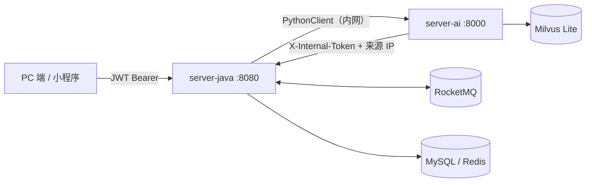

# 后端接口清单（Controller → Service → Mapper）

> 梳理时间：2026-10-13，逐文件核对源码，以代码为准。
> 范围：`server-java`（Spring Boot 业务服务）全量；`server-ai`（Python AI 服务）的 HTTP 接口见文末附录 B。
> 在线文档：Java Swagger `/swagger-ui.html`、Python `/docs`。文末附「梳理时发现的文档口径差异」，供顺手修正。

---

## 〇、总览

| 层 | 数量 | 说明 |
|----|------|------|
| Controller | 14 个（对外 11 + 内部 3），共 **64 个 HTTP 端点** | 对外 56 + 内部 8 |
| Service | 21 个文件（20 个接口 + 1 个聚合组件） | 认证/计划/错题/进度/通知/知识库/问答/报告/微信/桥接 |
| Mapper | 15 个 | 与 15 张表对应；7 个带自定义 SQL，8 个纯 BaseMapper |
| 异步入口 | 4 消费者 + 2 定时调度器 | RocketMQ 三业务 topic + 自检 topic |

**三种权限口径**：
- 匿名（白名单）：`/auth/**`、`/health`、`/error`、Swagger 相关；其中 `/auth/me`、`/auth/logout` 虽在 `/auth/**` 下但依赖登录上下文，未带 token 会失败；
- JWT（`Authorization: Bearer`）：其余全部对外接口，userId 一律取自 token，不接受前端传入；
- 内部令牌（`X-Internal-Token` + 来源 IP）：`/internal/**` 与 `/plan/agent-create`（`InternalTokenFilter`）。

---

## 一、HTTP 接口（Controller 层）

### 1. 认证 AuthController `/auth`（6 个）

| 方法 | 路径 | 干什么 |
|------|------|--------|
| POST | `/auth/register` | 账号注册（用户名唯一、BCrypt 加密；注册后不自动登录） |
| POST | `/auth/login` | 账号密码登录，签发 access(2h) + refresh(7d)，refresh 落 Redis |
| POST | `/auth/refresh` | 用 refresh 换新令牌（轮换策略：旧 refresh 立即失效） |
| POST | `/auth/logout` | 退出登录（删 Redis 中 refresh；不传 refreshToken 则全端下线）【需登录】 |
| POST | `/auth/wx-login` | 小程序登录：code → openid → 查/建用户 → 签发 JWT（无真实 AppID 时走 mock） |
| GET | `/auth/me` | 当前登录用户信息【需登录】 |

### 2. 用户 UserController `/user`（1 个）

| 方法 | 路径 | 干什么 |
|------|------|--------|
| GET | `/user/profile` | 当前用户信息探针（只回显 token 内信息不走库；前端路由守卫的登录态判定靶子） |

### 3. 健康检查 HealthController（1 个）

| 方法 | 路径 | 干什么 |
|------|------|--------|
| GET | `/health` | 存活探测：服务名、状态、服务器时间 |

### 4. 学习计划 StudyPlanController `/plan`（13 个）

| 方法 | 路径 | 干什么 |
|------|------|--------|
| GET | `/plan/page` | 分页查询计划（带任务完成统计，可按状态/考试类型过滤） |
| POST | `/plan` | 创建计划：任务清单由用户输入（服务层校验至少一条、日期须在计划范围内） |
| GET | `/plan/{planId}` | 计划详情（含统计；走 `plan:detail:{uid}:{pid}` 缓存，key 含 userId 防越权） |
| PUT | `/plan/{planId}` | 修改计划基础信息（不重建任务，避免冲掉已勾选进度） |
| DELETE | `/plan/{planId}` | 删除计划（逻辑删，级联删其下任务） |
| PUT | `/plan/{planId}/status` | 变更计划状态（进行中/已完成/已放弃） |
| GET | `/plan/task/list` | 任务列表（按计划 ID、日期区间、状态；详情页/日历用） |
| GET | `/plan/task/today` | 今日任务 + 完成情况汇总（PC/小程序首页） |
| POST | `/plan/task` | 手工新增一条任务 |
| PUT | `/plan/task/{taskId}` | 修改任务 |
| DELETE | `/plan/task/{taskId}` | 删任务（逻辑删，同时移除其学习记录） |
| PUT | `/plan/task/status` | 勾选/取消完成：置完成→写 `study_record`（进度唯一数据源）；改回待办→移除记录 |
| POST | `/plan/agent-generate` | AI 生成计划：Java 调 Python LangGraph Agent → Java 事务内落库（source=Agent生成） |

### 5. 错题本 WrongQuestionController `/wrong-question`（10 个）

| 方法 | 路径 | 干什么 |
|------|------|--------|
| GET | `/wrong-question/page` | 分页查询：科目/掌握度/题型/难度/标签/关键字/时间范围筛选，结果带标签 |
| GET | `/wrong-question/{id}` | 错题详情（带标签） |
| POST | `/wrong-question` | 新增错题（标签不存在自动创建；**发 MQ 异步 AI 打标**） |
| PUT | `/wrong-question/{id}` | 修改（tags=null 不改标签；空数组=清空标签） |
| DELETE | `/wrong-question/{id}` | 删除（逻辑删 + 清理标签关联） |
| DELETE | `/wrong-question/batch` | 批量删除（只删当前用户的，返回实际条数） |
| PUT | `/wrong-question/batch/mastery` | 批量标记掌握度（未掌握/复习中/已掌握） |
| GET | `/wrong-question/tags` | 标签列表（按被引用次数降序；走 `wrong:tags:{uid}` 缓存） |
| GET | `/wrong-question/export` | 导出 Excel（按当前筛选，单次上限 1 万条；直接文件流，不走统一返回体） |
| GET | `/wrong-question/mastery-options` | 掌握度枚举选项（避免前端硬编码） |

### 6. 进度统计 ProgressController `/progress`（3 个）

| 方法 | 路径 | 干什么 |
|------|------|--------|
| GET | `/progress/dashboard` | 进度页全量：概览卡片 + 4 张图数据（每日时长/完成率折线、科目饼图、掌握度柱状） |
| GET | `/progress/recent` | 近 N 天（1~365，默认 30）的 dashboard；小程序用 |
| GET | `/progress/overview` | 只要概览卡片数字（比 dashboard 轻） |

### 7. 站内通知 NoticeController `/notice`（6 个）

| 方法 | 路径 | 干什么 |
|------|------|--------|
| GET | `/notice/page` | 分页查询（未读优先再按时间倒序；可按类型/已读过滤） |
| GET | `/notice/unread-count` | 未读数（角标/红点） |
| PUT | `/notice/{id}/read` | 标记单条已读 |
| PUT | `/notice/read/batch` | 批量标记已读 |
| PUT | `/notice/read/all` | 全部标记已读 |
| DELETE | `/notice/{id}` | 删除通知（逻辑删） |

### 8. 知识库 KnowledgeBaseController `/kb`（5 个）

| 方法 | 路径 | 干什么 |
|------|------|--------|
| GET | `/kb/page` | 分页查询我的资料（可按解析状态过滤） |
| GET | `/kb/{documentId}` | 文档详情 |
| POST | `/kb/upload` | 上传资料（pdf/docx/txt/md，≤50MB；落盘即返回，后台异步解析入库） |
| POST | `/kb/{documentId}/reingest` | 重新解析（失败重试；覆盖旧切片与向量） |
| DELETE | `/kb/{documentId}` | 删除资料（清向量库 + 切片表 + 原始文件） |

### 9. AI 问答 ChatController `/chat`（4 个）

| 方法 | 路径 | 干什么 |
|------|------|--------|
| POST | `/chat/ask` | **SSE 流式问答**：Java 校验 JWT → 转发 Python → 透传流；结束后 Java 独占落库 user/assistant 两条消息（含 citations） |
| GET | `/chat/session/page` | 分页查询会话（按最后时间倒序） |
| GET | `/chat/session/{sessionId}/messages` | 会话消息列表（时间正序，含引用溯源 JSON；越权 403） |
| DELETE | `/chat/session/{sessionId}` | 删除会话（逻辑删；消息保留便于回溯） |

### 10. 复盘报告 ReportController `/report`（3 个）

| 方法 | 路径 | 干什么 |
|------|------|--------|
| GET | `/report/page` | 分页查询我的报告（周期倒序，不含正文大字段） |
| GET | `/report/{id}` | 报告详情（markdown 正文 + 统计 JSON + 要点/建议；越权 403） |
| POST | `/report/generate` | 手动触发生成（默认本周一~今天，最长 31 天；**异步**：只发 MQ 消息，前端轮询列表） |

### 11. 微信订阅消息 WxSubscribeController `/wx`（4 个）

| 方法 | 路径 | 干什么 |
|------|------|--------|
| GET | `/wx/templates` | 模板场景清单（小程序端据此发起授权） |
| POST | `/wx/subscribe` | 上报订阅授权结果（同意则额度 +1；拒绝不回收存量；按 用户+场景 幂等覆盖） |
| GET | `/wx/subscribe` | 我的订阅状态（各场景授权与否、剩余可发次数） |
| GET | `/wx/push-log` | 我的推送记录（success/failed/skipped+原因码） |

### 12. 内部接口（8 个，X-Internal-Token + 来源 IP）

| 方法 | 路径 | 干什么 | 归属 |
|------|------|--------|------|
| POST | `/plan/agent-create` | 落库 Agent 生成的计划与任务（Python `persist=true` 兼容链路的回调入口；**当前主链路不用它**，见备注） | AgentPlanController |
| POST | `/internal/kb/chunks` | 回写切片元数据（覆盖式写入，user_id 以文档记录为准，不信任 Python 传值） | InternalController |
| PUT | `/internal/kb/document/{documentId}/status` | 更新文档解析状态（解析中/完成/失败 + chunkCount/errorMsg） | InternalController |
| POST | `/internal/kb/document-names` | 批量查文档名（Python 生成引用溯源用） | InternalController |
| POST | `/internal/chat/messages` | 保存一轮问答消息（幂等补写入口，**非 SSE 场景**用；SSE 链路由 Java 独占落库） | InternalController |
| GET | `/internal/chat/history` | 取会话历史（Python 拼多轮 prompt 用，默认最近 12 条） | InternalController |
| POST | `/internal/mq/selfcheck` | MQ 环回自检（发消息等消费者回执，验证收发链路） | MqSelfCheckController |
| POST | `/internal/mq/wx-push` | 手动投递一条订阅消息（联调/验收用，走真实消费者） | MqSelfCheckController |

> 备注：`/plan/agent-create` 存在两条 Agent 落库链路 —— ① 主链路：前端 → `/plan/agent-generate` → Java 调 Python（只生成）→ **Java 直接落库**；② 兼容链路：Python `/agent/plan` 带 `persist=true` 时回调本接口落库。当前前端走的是 ①。

---

## 二、Service 层（21 个）

> 所有业务服务「写入」均落在 Java 侧；Python 需要写库一律回调 `/internal/**`（单一写入口纪律）。

| Service（实现） | 干什么 |
|-----------------|--------|
| **AuthService**（AuthServiceImpl） | 注册 / 登录（签发双 token）/ 刷新（轮换）/ 登出（删 Redis + 全端下线）/ 微信登录（code→openid→查建用户）/ 当前用户信息 |
| **SysUserService**（SysUserServiceImpl） | 用户基础 CRUD；覆写 getById / updateById 挂 `user:info:{id}` 缓存（TTL 30min，写后失效） |
| **StudyPlanService**（StudyPlanServiceImpl） | 计划 CRUD / 状态流转 / 详情（Cache Aside，`plan:detail:{uid}:{pid}` TTL 10min）/ `createPlan` 落用户任务清单 / `generateByAgent` 调 Python 后事务落库 / `requireOwnedPlan` 归属校验 |
| **PlanTaskService**（PlanTaskServiceImpl） | 任务 CRUD / 列表 / 今日视图 / `changeStatus` 勾选联动写删 `study_record` / `requireOwnedTask` 归属校验 |
| **WrongQuestionService**（WrongQuestionServiceImpl） | 错题 CRUD / 批量删与批量掌握度 / 导出数据（上限保护）/ 标签统计 / `appendTags` 幂等追加（供 AI 打标签消费者）/ `requireOwned` 归属校验 |
| **WrongQuestionTagService**（Impl） | 标签基础 CRUD（IService 通用能力，无自定义方法） |
| **WrongQuestionTagRelService**（Impl） | 标签关联基础 CRUD（IService 通用能力） |
| **StudyRecordService**（Impl） | 学习记录基础 CRUD（明细由任务勾选写入，无自定义方法） |
| **ProgressService**（ProgressServiceImpl） | `dashboard`（概览 + 4 图数据）/ `recent`（近 N 天）；统计口径的唯一出处（报告聚合也复用） |
| **NoticeMessageService**（NoticeMessageServiceImpl） | 通知列表 / 未读数 / 已读（单条/批量/全部）/ 逻辑删 / `push`（供定时任务与 MQ 消费者写通知） |
| **KnowledgeBaseService**（KnowledgeBaseServiceImpl） | 上传（落盘+写状态）/ 分页 / 重解析 / 删除（清向量）+ `requireOwnedDocument` / `getDocumentNames`（内部） |
| **KbDocumentService**（Impl） | 文档基础 CRUD（IService 通用能力） |
| **KbChunkService**（Impl） | 切片基础 CRUD（IService 通用能力） |
| **ChatService**（ChatServiceImpl） | `askStream`：校验 → 转发 Python SSE → 边透传边独占落库（断连保部分内容） |
| **ChatSessionService**（Impl） | 会话基础 CRUD（IService 通用能力） |
| **ChatMessageService**（Impl） | 消息基础 CRUD（IService 通用能力） |
| **ReviewReportService**（ReviewReportServiceImpl） | 报告列表 / 详情（越权 403）/ `upsertReport` 同周期幂等覆盖（唯一键兜底） |
| **ReportAggregator**（组件，非接口） | 聚合统计（复用 ProgressService 口径）→ 给 Python `/agent/report` 的输入；保证"报告数字=进度页数字" |
| **WxSubscribeService**（WxSubscribeServiceImpl） | 授权记账：record（幂等覆盖）/ listMy / hasApproved（授权与额度分开判定）/ consumeQuota（原子扣减） |
| **WxPushService**（WxPushServiceImpl） | `getAccessToken`（Redis 缓存 + SETNX 锁提前 5 分钟刷新）/ `push`（openid→授权→额度→发送，状态机落 `wx_push_log`）/ recentLogs |
| **PythonClient**（PythonClientImpl） | Java→Python 的 HTTP 客户端：`ingest`（解析入库）/ `deleteVectors` / `generatePlan`（只生成）/ `classify` / `generateReport` |

---

## 三、Mapper 层（15 个）

| Mapper | 对应表 | 自定义方法（除 MyBatis-Plus 通用 CRUD 外） |
|--------|--------|--------------------------------------------|
| SysUserMapper | `sys_user` | 无（纯 BaseMapper） |
| StudyPlanMapper | `study_plan` | 无 |
| PlanTaskMapper | `plan_task` | `listUserIdsWithPendingTasks`（当天有待办的 userId，学习提醒）；`countPendingTasks`（某人某天待办数） |
| WrongQuestionMapper | `wrong_question` | `countCreatedSince`（某时刻后新增数）；`listUsersWithMastery`（未掌握数≥阈值的 userId，复习提醒；一条 SQL 防 N+1） |
| WrongQuestionTagMapper | `wrong_question_tag` | `listTagsWithCount`（标签+引用次数，LEFT JOIN 保住零引用标签）；`selectByNames`（批量查 ID）；`listTagsByQuestionIds`（批量补标签防 N+1）；`selectQuestionIdsByTags`（多标签交集筛选，GROUP BY+HAVING） |
| WrongQuestionTagRelMapper | `wrong_question_tag_rel` | 无 |
| StudyRecordMapper | `study_record` | `sumMinutesByDate`（每日时长）；`sumMinutesBySubject`（科目分布）；`sumMinutes`（区间总时长）；`listStudyDates`（连续学习天数，覆盖索引）；`listActiveUserIds`（周报活跃用户口径） |
| NoticeMessageMapper | `notice_message` | 无 |
| KbDocumentMapper | `kb_document` | 无 |
| KbChunkMapper | `kb_chunk` | 无 |
| ChatSessionMapper | `chat_session` | 无 |
| ChatMessageMapper | `chat_message` | 无 |
| ReviewReportMapper | `review_report` | `upsert`（唯一键 `uk_user_period` + ON DUPLICATE KEY UPDATE，防 TOCTOU 并发重复）；`findByPeriod`（回查/快速判定） |
| WxSubscribeMapper | `wx_subscribe` | `selectByKey` / `selectByKeys` / `selectByUser`；`consumeQuota`（`accept_count > 0` 写进 WHERE，数据库层原子扣减） |
| WxPushLogMapper | `wx_push_log` | `recent`（最近若干条）；`countByStatus`（按状态计数，验收脚本用） |

---

## 四、附录 A：异步与定时入口（非 HTTP）

| 入口 | 触发 | 干什么 |
|------|------|--------|
| WrongClassifyConsumer | 消费 `wrong-classify` | 新增错题后：调 Python `/agent/classify` 打标 → `appendTags` 幂等回写 |
| ReportGenerateConsumer | 消费 `report-generate` | ReportAggregator 聚合 → 调 Python `/agent/report` 生成 → `upsertReport` 落库 → 写站内通知 + 发 `wx-push` |
| WxPushConsumer | 消费 `wx-push` | 查 openid → 校验授权/额度 → access_token → `subscribeMessage.send` → 落 `wx_push_log`（终态 skipped 不重试） |
| SelfCheckConsumer | 消费 `mq-selfcheck` | 回执登记（环回自检用，不承载业务数据） |
| ReportScheduler | `@Scheduled` 周日 20:00（`report.cron` 可配） | 找周期内有学习记录的活跃用户，逐个投递 `report-generate` |
| RemindScheduler | `@Scheduled` 每天 8:00 / 20:00（`wx.reminder-cron` / `wx.review-cron` 可配） | 学习提醒（当天有待办且已授权）/ 错题复习提醒（未掌握达阈值且已授权），投递 `wx-push` |

Topic 与消费者组（`MqTopics`）：

| Topic | 消费者组 | 消息体 |
|-------|----------|--------|
| `wrong-classify` | `study-agent-wrong-classify` | {wrongQuestionId, content, subject, traceId} |
| `report-generate` | `study-agent-report-generate` | {userId, periodStart, periodEnd, traceId} |
| `wx-push` | `study-agent-wx-push` | {userId, templateKey, page, data, traceId} |
| `mq-selfcheck` | `study-agent-mq-selfcheck` | 环回自检专用 |

---

## 五、附录 B：server-ai（Python）HTTP 接口

> 前缀由各 router 定义：`/agent`、`/rag`、`/debug`；health 无前缀。全部响应带 `X-Trace-Id` 回写。

| 方法 | 路径 | 干什么 |
|------|------|--------|
| GET | `/` | 服务自述（版本、文档地址） |
| GET | `/health` | 服务健康（含本地模型加载状态、LLM 配置状态） |
| GET | `/health/llm` | 大模型连通性检查 |
| GET | `/health/db` | MySQL 连通性检查 |
| POST | `/debug/embed` | 嵌入探针：返回向量维度（验证 BGE-M3 就绪） |
| POST | `/debug/rerank` | 重排探针：返回重排分数（验证 Reranker 就绪） |
| GET | `/debug/stream` | SSE 流式探针（思考链/正式回答分离） |
| POST | `/rag/ingest` | 文档入库：解析→分块→向量化→写 Milvus + 回调 Java 回写切片 |
| GET | `/rag/stats` | 向量库统计（与 kb_chunk 行数对账，验收用） |
| DELETE | `/rag/document/{document_id}` | 删除某文档全部向量 |
| POST | `/rag/chat` | RAG 流式问答（SSE：start/reasoning/message/citations/error 帧） |
| POST | `/agent/classify` | 错题归类：科目建议 + 知识点标签 + 难度估计 |
| POST | `/agent/report` | 复盘报告：数字→markdown 正文 + 要点 + 建议 |
| POST | `/agent/plan` | 规划 Agent（LangGraph 三节点）；`persist=true` 时回调 Java `/plan/agent-create` 落库 |

**跨服务调用关系**：
- Java → Python（`PythonClient`）：`/rag/ingest`、`/rag/document/{id}`(DELETE)、`/agent/classify`、`/agent/report`、`/agent/plan`；
- Python → Java（`java_client.py`，带 X-Internal-Token）：`/internal/kb/chunks`、`/internal/kb/document/{id}/status`、`/internal/kb/document-names`、`/internal/chat/history`、`/internal/chat/messages`（保留）、`/plan/agent-create`（persist=true 兼容链路）。

---

## 六、附：梳理时发现的文档口径差异（建议顺手修）

1. `StudyPlanController#create` 的 Swagger `@Operation` 仍写「自动均摊生成逐日任务」，成功文案也是「已自动生成任务」——实际行为已于 2026-10-11 改为**用户自定义任务清单**（均摊生成器已删）；
2. `StudyPlanService#createPlan` 接口注释同样写「按每日时长均摊生成 plan_task」，口径陈旧；
3. Swagger Tag 编号重复：知识库与复盘报告都是 `07-`；AI 问答与微信订阅消息都是 `08-`（仅影响 Swagger 分组排序观感）。

> 以上均为注释/文案问题，不影响功能；修完需重新打包（`mvn -DskipTests package`）才在 Swagger 生效。
