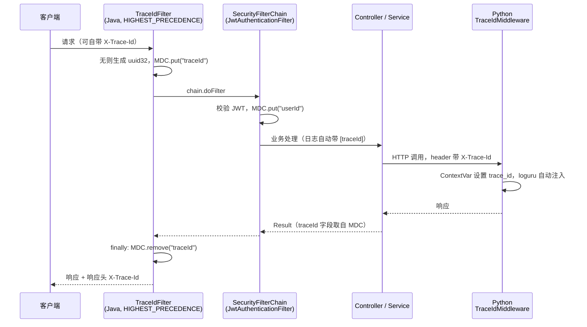

# 架构说明

## 一、整体架构

见 [`docs/images/architecture.svg`](images/architecture.svg)。

分层从上到下：

| 层 | 组成 | 职责 |
|----|------|------|
| 客户端层 | Vue3 PC 端、UniApp 小程序、Swagger | 交互；不直接连 Python |
| 接入层 | Nginx + Spring Security 过滤器链 | 静态资源、反向代理、JWT 鉴权、traceId 生成 |
| 服务层 | Java(8080) + Python(8000) | Java 管业务与权限，Python 管 AI 能力 |
| 中间件层 | MySQL / Redis / Milvus / RocketMQ | 业务数据、缓存与会话、向量、异步消息 |
| 外部 | 阿里云百炼 qwen3.7-flash | 唯一的外部付费依赖（有免费额度） |

## 二、为什么拆成双栈

**不是"为了微服务而微服务"，是按能力边界拆的。**

1. **AI 生态在 Python**：LangChain / LangGraph 做 Agent 编排、FlagEmbedding 做本地 BGE 模型推理、pymilvus 做向量检索，这套组合在 Python 上是一等公民。硬搬到 Java 要么用不成熟的封装，要么自己造轮子。
2. **业务工程化在 Java**：事务边界、`@Transactional` 传播行为、Spring Security 过滤器链、RocketMQ 的可靠投递与消费重试、MyBatis-Plus 的动态 SQL 与分页，都是 Java 的主场；团队协作与后续维护也更规范。
3. **边界怎么切**：**Java 是唯一写入口**。Python 需要写库时（比如回写 `kb_chunk`、更新 `kb_document` 状态）不直连 MySQL，而是回调 Java 的内部接口。代价是多一次内网 HTTP，换来的是权限校验、事务、审计、traceId 全部只在一处实现。
4. **Python 不做鉴权**：只监听内网 / 本机，安全边界由 Java 承担。对外永远只有 8080 一个入口。

### 为什么不干脆全用 Python

业务侧的分布式事务、消息幂等、缓存一致性这些工程化诉求，Java 的生态成熟度和可讲性都更强；而且这个项目的简历定位是"Java 后端 + AI 落地"，双栈本身就是加分项。

## 三、模块职责

### Java 业务服务（server-java，8080）

| 包 | 内容 |
|----|------|
| `common` | `Result<T>` 统一返回、`BizException`、`GlobalExceptionHandler`、`TraceIdFilter` |
| `config` | MyBatis-Plus 分页与自动填充、Spring Security、OpenAPI、Redis、RocketMQ |
| `entity` / `mapper` / `service` | 13 张表对应的三层 |
| `controller` | 对外 REST 接口（`/auth`、`/plan`、`/wrong-question`、`/progress`、`/notice`、`/kb`、`/chat`、`/report`） |
| `mq` | RocketMQ 生产者与三类消费者 |
| `job` | `@Scheduled` 定时任务（周报生成、每日学习提醒） |

### Python AI 服务（server-ai，8000）

| 目录 | 内容 |
|------|------|
| `app/core` | 配置（pydantic-settings）、loguru 日志、traceId 中间件、LLM 客户端工厂、异常 |
| `app/routers` | `/health`、`/rag`、`/plan`、`/agent` |
| `app/services` | BGE-M3 嵌入、BGE-Reranker 重排、文档解析分块、Milvus 客户端、会话上下文 |
| `app/models` | pydantic 请求/响应模型、LLM 结构化输出的 schema |
| `scripts` | 模型下载与自检脚本 |

## 四、跨栈可观测性：traceId 全链路

这是整个项目里最能体现"工程意识"的一个点，实现分四段：

1. **Java 入口生成**：`TraceIdFilter`（`Ordered.HIGHEST_PRECEDENCE`）优先取请求头 `X-Trace-Id`，没有就用 UUID 生成；放入 MDC 并回写响应头。
2. **Java 日志打印**：`logback-spring.xml` 的 pattern 里带 `[%X{traceId}]`，每行日志都能定位到请求；`finally` 里 `MDC.remove` 防止线程池串号。
3. **跨进程透传**：Java 调 Python 时在 HTTP header 带 `X-Trace-Id`。
4. **Python 接续**：纯 ASGI `TraceIdMiddleware` 读同一个头放进 `ContextVar`，loguru 通过 `patcher` 自动注入每条日志。

结果：一次问答请求的日志，在 `server-java` 和 `server-ai` 两个日志文件里可以用同一个 traceId 串起来。

> 面试追问"跨语言链路怎么追"的答案就是这四段，不用引入 SkyWalking / Zipkin 重型组件。

### traceId 端到端时序

> 实现细节：`TraceIdFilter` 是 Servlet 层过滤器且 `@Order(HIGHEST_PRECEDENCE)`，
> 而 Spring Security 的过滤器链是 `DelegatingFilterProxy` 注册的，两者在**同一个线程**上顺序执行，
> 所以 Security 里的认证日志、MyBatis 的 SQL 日志都能带上 traceId。
> `finally` 里必须 `MDC.remove`，否则 Tomcat 线程池复用会让下一个请求"继承"上一个请求的 traceId
> —— 这是一个真实踩过的高频事故。

## 五、可替换点（面试时主动说清楚）

| 当前实现 | 生产可替换为 | 说明 |
|---------|-------------|------|
| Milvus Lite（本地文件） | Milvus 集群 / 阿里云向量检索 | 接口不变，只换连接串 |
| `@Scheduled` 定时任务 | XXL-Job / PowerJob | 需要分布式调度与失败重试时替换 |
| 本地 BGE-M3 / Reranker（CPU） | DashScope text-embedding / GPU 推理 | 本地零成本但吞吐有限 |
| Java 透传 SSE | 前端直连 Python | 牺牲统一鉴权换一跳延迟，当前选择透传 |
| 单库单表 + 联合索引 | 读写分离 / 分库分表 | 数据量上来后的演进方向 |

## 六、关键设计决策记录

| 决策 | 选择 | 理由 |
|------|------|------|
| 状态字段类型 | 中文字符串而非数字编码 | SQL 直接 `group by` 出图表数据；演示可读性好 |
| 逻辑删除范围 | 仅主业务表 | 明细表是统计事实，删了历史对不上 |
| 消息幂等 | 业务唯一键 + `ON DUPLICATE KEY UPDATE` | 不引入分布式锁，最简单且够用 |
| 引用溯源载体 | `chat_message.citations` JSON | 拆表会让每次问答多两次写库，收益不匹配 |
| SSE 端点 | Java 透传 | 权限校验统一，前端只认一个域名 |
| 嵌入/重排模型 | 服务启动后懒加载并常驻 | 避免启动阻塞；也避免每次请求重新加载 |
