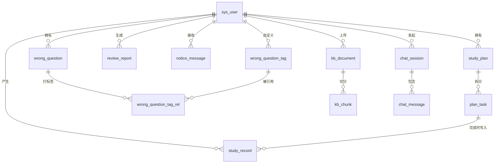

# 表设计说明（study_agent）

> 数据库：MySQL 8.0.37 ｜ 字符集 utf8mb4 ｜ 引擎 InnoDB ｜ 共 13 张表
> 建表脚本：[`sql/init.sql`](../sql/init.sql)（幂等，可重复执行）

## 一、表清单

| # | 表名 | 中文名 | 说明 |
|---|------|--------|------|
| 1 | `sys_user` | 用户表 | 账号密码 + 微信小程序双登录链路 |
| 2 | `study_plan` | 学习计划表 | `source` 区分手动创建 / Agent 生成 |
| 3 | `plan_task` | 计划任务表 | 逐日粒度，计划页与进度统计的最小单元 |
| 4 | `wrong_question` | 错题表 | 错题本主体 |
| 5 | `wrong_question_tag` | 错题标签表 | AI 归类写入的目标表 |
| 6 | `wrong_question_tag_rel` | 错题标签关联表 | 多对多，唯一键兼作消费幂等键 |
| 7 | `study_record` | 学习记录表 | 进度追踪数据源 |
| 8 | `review_report` | 复盘报告表 | markdown 正文 + ECharts 数据 JSON |
| 9 | `notice_message` | 站内通知表 | PC 站内通知，与微信订阅消息互补 |
| 10 | `kb_document` | 知识库文档表 | 上传文件与解析状态 |
| 11 | `kb_chunk` | 文档切片表 | 与 Milvus 向量双向定位 |
| 12 | `chat_session` | 问答会话表 | RAG 问答会话 |
| 13 | `chat_message` | 问答消息表 | 消息 + citations 引用溯源 JSON |

## 二、ER 关系



要点：

1. **`plan_task.user_id` 是刻意的冗余**。进度统计要按用户 + 日期区间聚合，冗余后可直接命中 `idx_user_date`，无需 join `study_plan` 回表。
2. **`kb_chunk` ↔ Milvus 双向定位**。MySQL 存文本与元数据（页码、切片序号），Milvus 存向量；`kb_chunk.vector_id` 指向 Milvus 主键，检索命中向量后再回 MySQL 取原文，引用溯源才能给出"文档名 + 页码"。
3. **`wrong_question_tag_rel` 的唯一键是幂等设计的载体**。第 4 周 RocketMQ 的 `wrong-classify` 消息可能重复投递，消费端用 `INSERT ... ON DUPLICATE KEY UPDATE` 落这个唯一键，重复消费天然无副作用（面试点：消费幂等用业务键去重）。
4. **`chat_message.citations` 用 JSON 类型**。引用溯源是"一段结构化的来源列表"，拆成独立表会让每次问答多两次写库；MySQL 8 的 JSON 类型既能原样返回给前端，又能用 `->>` 做简单过滤。

## 三、索引设计

所有索引遵循「等值条件在前、范围条件在后」的联合索引顺序，让最左前缀能持续生效。

| 表 | 索引 | 列顺序 | 服务的查询 |
|----|------|--------|-----------|
| `plan_task` | `idx_plan_date` | `plan_id, task_date` | 计划详情页取某天任务 |
| `plan_task` | `idx_user_date` | `user_id, task_date` | 今日任务、按周统计完成率 |
| `wrong_question` | `idx_user_subject_mastery` | `user_id, subject, mastery` | 错题列表按科目 + 掌握度筛选 |
| `study_record` | `idx_user_date` | `user_id, study_date` | 近 30 天每日时长折线 |
| `chat_message` | `idx_session_id` | `session_id, id` | 会话消息按时间正序翻页 |
| `kb_chunk` | `idx_document_chunk` | `document_id, chunk_index` | 按文档取全部切片 |
| `notice_message` | `idx_user_read` | `user_id, read_flag` | 未读角标 |
| `sys_user` | `uk_username` | `username` (唯一) | 登录校验 |
| `wrong_question_tag_rel` | `uk_question_tag` | `wrong_question_id, tag_id` (唯一) | 幂等去重 |

> 第 5 周会用 `slow query log` + `EXPLAIN` 实测这些索引是否被优化器选中，并把优化前后的执行计划截图留档到 `docs/`。

**已知的待优化点（第 5 周处理）**：`wrong_question` 列表在"按时间倒序 + 深翻页"场景下，`user_id` 等值 + `create_time` 排序无法同时命中 `idx_user_subject_mastery`，计划改用 id 游标分页（`where id < lastId order by id desc limit N`）。

## 四、状态枚举约定

系统内所有状态字段都用**中文字符串**而非数字编码，原因有二：一是 SQL 里直接 `group by subject` 出来的结果可直接给前端图表用，省掉一层映射；二是面试演示时数据可读性高。字段长度都足够（`varchar(16)`）。

| 字段 | 取值 |
|------|------|
| `sys_user.status` | `1` 正常 / `0` 禁用 |
| `study_plan.status` | 进行中 / 已完成 / 已放弃 |
| `study_plan.source` | 手动 / Agent生成 |
| `plan_task.status` | 待办 / 完成 / 跳过 |
| `wrong_question.mastery` | 未掌握 / 复习中 / 已掌握 |
| `kb_document.parse_status` | 待解析 / 解析中 / 完成 / 失败 |
| `notice_message.type` | 提醒 / 复习 / 报告 |
| `notice_message.channel` | PC / 小程序 |
| `chat_message.role` | user / assistant / system |

## 五、逻辑删除

`study_plan`、`plan_task`、`wrong_question`、`chat_session` 使用 `deleted tinyint`（0 未删 / 1 已删），配合 MyBatis-Plus 的 `@TableLogic` + 全局配置 `logic-delete-field: deleted`，业务代码里的 `removeById` 会自动转成 `update ... set deleted = 1`，避免物理删除导致的历史统计对不上。

`study_record`、`chat_message`、`kb_chunk` 等明细表不做逻辑删除：它们是统计和溯源的事实记录，删除主表时按 `user_id` 归档即可。

## 六、执行记录

```bash
# 建库建表（幂等）
mysql -uroot -p123456 < sql/init.sql

# 校验
mysql -uroot -p123456 -D study_agent -e "show tables;"
```

- [x] 13 张表创建成功，重复执行不报错
- [x] 关键联合索引已确认存在（`show index from plan_task / wrong_question / kb_chunk`）
- [x] 演示账号 `demo` / `123456` 已写入（BCrypt 密文由 `BCryptPasswordEncoder(10)` 生成）
